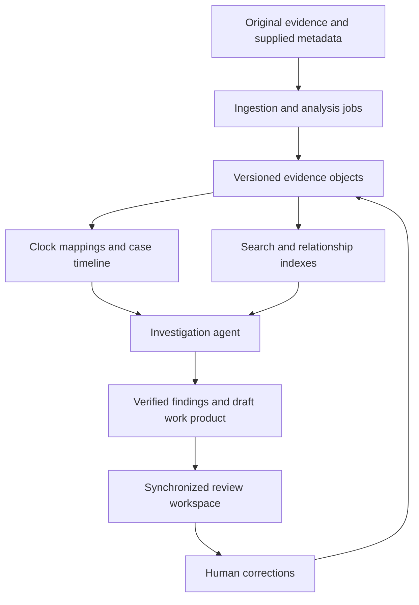

# VisLex: a complete legal investigation and synchronized evidence platform

## 1. Product goal and research findings

Build an autonomous legal investigation workspace that can ingest a case, analyze its evidence, reconcile timelines, investigate competing explanations, research U.S. authorities, and produce source-linked work product.

**The central upgrade is a shared, versioned evidence model.** Video, audio, photographs, reports, metadata, legal authorities, and AI findings must participate in the same system. This gives the AI durable knowledge it can query and verify instead of repeatedly reconstructing the case from text.

Your selected requirements:

- Single-user Windows desktop application.
- Capacity target: **200 recording hours and 10,000 documents per case**.
- Local authoritative storage with optional cloud AI and GPU processing.
- Prioritize analysis quality and speed.
- Autonomous analysis, investigation, research, and drafting.
- Human approval for external sharing, filing, destructive actions, and purchases.
- Public U.S. legal sources only.
- Complete product scope; the stages below establish implementation order rather than a reduced product.

“Better than Harvey” becomes a benchmark objective: more accurate synchronized evidence analysis, better-supported conclusions, and less manual review time on representative cases. No system can credibly promise omniscience or universal superiority.

**What the current app needs most**

The repository has valuable foundations: preserved originals, hashes, SQLite, artifact history, sandboxed processors, full-recording transcription, and an investigative tool loop. Its principal limitations are:

| Current behavior | Required change |
|---|---|
| Events, people, claims, and clock notes primarily live in text records | Structured, linked, versioned evidence objects |
| Passage search scans extracted text and working records | Indexed lexical, semantic, temporal, and relational retrieval |
| Tools run serially; processing often holds the case lock | Persistent parallel jobs with short database transactions |
| Speech uses the tiny transcription model | Detailed transcription, alignment, speaker turns, sound detection |
| Video understanding relies on sampled frames | Temporal clip analysis, tracking, coverage accounting, targeted verification |
| Citation validation checks location | Separate checks for location, quotation accuracy, evidentiary support, and contrary evidence |
| Updates broadly mark unrelated records stale | Precise dependency tracking and targeted reanalysis |

The existing verification notes document a correct frame timestamp paired with an incorrect scene description. That failure becomes a mandatory regression case.

**Research informs the target**

- Harvey establishes useful expectations for document collections, review tables, cited analysis, and reusable workflows. [Harvey Vault](https://www.harvey.ai/platform/vault)
- Everlaw demonstrates synchronized media/transcript review; Relativity documents review recommendations with supporting citations and rationale. [Everlaw Media Review](https://support.everlaw.com/hc/en-us/articles/204898319-Media-Review), [Relativity aiR Review](https://help.relativity.com/RelativityOne/Content/Relativity/aiR_for_Review/aiR_for_Review.htm)
- VisLex’s proposed differentiator is **precise cross-recording time reconciliation connected to documents, competing claims, and reproducible investigations**. This is a product strategy, not a verified claim that competitors lack every component.
- Citation-backed retrieval still needs substantive verification; research on legal AI has documented errors despite retrieval. [Stanford study](https://law.stanford.edu/publications/hallucination-free-assessing-the-reliability-of-leading-ai-legal-research-tools/)

## 2. Shared data architecture and synchronization

### A. Keep a desktop architecture, strengthen its internals

Retain Tauri, React, Rust, and Python processors.

Use:

- **SQLite:** authoritative case metadata, evidence relationships, revisions, jobs, permissions, and audit records.
- **SQLite FTS5:** exact phrases, names, identifiers, citations, and document text.
- **Embedded LanceDB:** rebuildable semantic and multimodal indexes.
- **Content-addressed files:** originals and retained artifacts.
- **Separate disposable caches:** waveform tiles, spectrogram tiles, preview images, and playback accelerators.

SQLite remains appropriate for this single-user scope. Replace the broad case mutex with one database writer queue and separate read connections; workers perform expensive computation outside database transactions. SQLite WAL supports concurrent readers and a writer. [SQLite WAL](https://www.sqlite.org/wal.html)

### B. Introduce explicit evidence objects

All objects receive stable IDs, revisions, provenance, review state, and source restrictions.

| Object | What it represents |
|---|---|
| Source / occurrence | Original bytes and each separately supplied copy |
| Artifact / analysis run | A derived output, its inputs, model, settings, and software versions |
| Evidence unit | Document paragraph, page region, table cell, transcript word, audio interval, or frame |
| Metadata assertion | Raw metadata value, extraction method, interpretation, and uncertainty |
| Entity / mention | A person, device, vehicle, location, or organization and its individual appearances |
| Observation | Something extracted, heard, or seen at a specific location |
| Statement | What a report, witness, officer, or other source asserts |
| Event hypothesis | A proposed real-world occurrence linked to supporting and conflicting observations |
| Clock / anchor / mapping | A source clock and its proposed relationship to other clocks |
| Claim / issue / authority | A factual proposition, legal question, or retrieved legal source |
| Relationship | Supports, contradicts, derived-from, same-event candidate, precedes, or identifies |
| Review / correction | Human decisions and changes without deleting prior interpretations |
| Work product / dependency | Reports and drafts linked to the precise evidence revisions they use |

**Important distinction:** “The report states three knocks” and “the audio contains three candidate impacts” are separate objects. The app can connect and compare them without converting either into an unquestioned fact.

Entity resolution also remains reversible. Speaker labels, camera ownership, reported names, and visible people are not automatically merged.

### C. One locator system across every format

Add a typed `EvidenceLocator` contract containing the source, artifact or extraction revision, and a modality-specific location:

- Documents: physical page, text span, bounding box, and printed/Bates label separately.
- Spreadsheets: workbook, sheet, cell/range, formula and cached value.
- Audio: stream, channel, sample range, and native timestamps.
- Video: stream, decoded PTS, rational timebase, and frame region.
- Photographs: original pixel coordinates and orientation transform.
- Email: message, header/body section, and attachment relationship.

Citations reference immutable locations. Human-friendly timestamps and page labels are renderings of those locations.

### D. Treat time reconciliation as a dedicated subsystem

Preserve distinct time concepts:

1. Native media PTS/sample time.
2. Player-relative time.
3. Device clock or visible timestamp overlay.
4. Reported incident time.
5. File creation/modification/export time.
6. Estimated shared incident time.

Never substitute one for another silently. QuickTime metadata itself has timezone interpretation pitfalls. [ExifTool QuickTime documentation](https://exiftool.org/TagNames/QuickTime.html)

For each recording:

- Extract stream timing, edit offsets, device metadata, available GPS, overlays, and supplied sidecars.
- Preserve raw values before normalization.
- Record timezone as known, inferred, ambiguous, or unknown.
- Detect discontinuities, missing audio, variable frame rates, and possible recording segments.
- Keep capture-session and export relationships separate.

For alignment:

- Find candidate shared anchors using audio fingerprints, transients, matching speech, visible events, and supplied dispatch logs.
- Refine matching audio with local correlation.
- Fit an offset first; estimate drift only with multiple anchors spread through the recording.
- Use piecewise mappings when a clock jumps or a recording restarts.
- Store residual errors, usable range, supporting anchors, alternatives, and uncertainty.
- Require at least three consistent anchors spanning 60 seconds before automatically publishing a drift estimate. Shorter matches remain provisional offset estimates.
- Keep unresolved recordings on separate timelines.
- Account for propagation delays, radio retransmission, and repeated similar sounds when evaluating anchors.

The mapping is conceptually `incident_time = scale × source_time + offset`, with separate segments and uncertainty where needed.

Reports and photographs can have approximate time ranges. They must not acquire artificial frame-level precision merely because they appear on the same timeline.

Frame-timing validation follows dedicated forensic guidance rather than assuming frame number divided by nominal FPS is exact. [SWGDE video guidance](https://www.swgde.org/documents/published-by-committee/video/)

### E. Make all views and reports update consistently

Publish typed change events after committed revisions:

`EvidenceAdded`, `AnalysisPublished`, `TranscriptCorrected`, `ClockMappingChanged`, `EntityLinkChanged`, and `ReviewChanged`.

Those events:

- Refresh affected timeline lanes and search indexes.
- Recompute derived time displays.
- Mark dependent claims and work product stale.
- Queue targeted reanalysis.
- Preserve historical reports against their original evidence and clock revisions.

New evidence also invalidates findings that claimed case-wide coverage. Unrelated source-level findings remain unchanged.

Use a transactional outbox so database commits and index updates cannot silently diverge. Every search result carries its indexed revision and currentness status.

## 3. Analysis, retrieval, and a substantially more capable agent

### A. Comprehensive ingestion and analysis

**Documents and images**

Support PDF, scanned PDF, DOCX, XLSX/CSV, TXT, images, email with attachments, and bounded archive ingestion. Preserve document families, versions, duplicate occurrences, native text, OCR text, layout, comments, and tracked changes where supported.

Use Docling as the structured document-conversion baseline, retaining page geometry and table structure. Preserve existing extractors for comparison and fallback. Unsupported structures appear in coverage reports. [Docling document model](https://docling-project.github.io/docling/reference/docling_document/)

Photographs receive orientation-aware viewing, metadata inspection, OCR, region annotations, and similarity search. Enhancement outputs are labeled derivatives and cannot replace original detail.

**Audio**

- Use `faster-whisper` with `large-v3` as the detailed transcription baseline; keep tiny for quick previews.
- Add WhisperX alignment and pyannote speaker diarization.
- Preserve channels; speech processing must not discard the input needed for environmental sounds.
- Detect overlap, clipping, dropouts, faint speech, and uncertain words.
- Store alternative transcriptions for disputed intervals.
- Keep translation separate from original-language transcription.

These components support the proposed speech pipeline; their accuracy still requires evaluation on bodycam recordings. [faster-whisper](https://github.com/SYSTRAN/faster-whisper), [WhisperX](https://github.com/m-bain/whisperX), [pyannote](https://github.com/pyannote/pyannote-audio)

**Knocks and environmental sounds**

Combine broad classification with precise transient analysis:

- YAMNet baseline for sound classes.
- CLAP for text-to-audio candidate retrieval.
- Short-time energy and spectral-flux analysis for impact onset refinement.
- Burst grouping that preserves individual hits and uncertainty.
- Context classification to distinguish possible knocks, slams, footsteps, handling noise, and unknown impacts.

A classifier score is stored as a score, not presented as a calibrated probability unless calibration has passed evaluation. [YAMNet](https://www.tensorflow.org/tutorials/audio/transfer_learning_audio), [CLAP](https://github.com/LAION-AI/CLAP)

**Video**

Run a complete inexpensive signal scan, followed by overlapping visual-analysis windows and targeted deep inspection:

- Shot boundaries, motion changes, quality changes, and timestamp overlays.
- Regular frame sampling plus dense windows around audio events and user questions.
- Short-clip analysis for actions that require before/during/after context.
- Within-recording object tracks and region annotations.
- Cross-camera candidate matches using time, appearance, location, and corroboration.
- Explicit visibility, occlusion, and analysis-coverage records.

Use Qwen3-VL-32B as a reproducible remote-GPU visual baseline and SAM 2 for assisted region tracking. Configured cloud models can serve as challengers or independent reviewers. Tracking does not establish identity, and sampled analysis does not establish exhaustive understanding. [Qwen3-VL](https://github.com/QwenLM/Qwen3-VL), [SAM 2](https://github.com/facebookresearch/sam2)

Every model package is pinned by revision and hash. Promote replacements only through the evaluation suite.

### B. Faster, more reliable retrieval

Implement a combined query pipeline:

1. Apply case, source, restriction, revision, time, and entity filters.
2. Retrieve lexical and semantic candidates.
3. Merge rankings.
4. Rerank candidates.
5. Expand adjacent passages and related evidence.
6. Return compact evidence packets with original locators.

Use BGE-M3 embeddings and `bge-reranker-v2-m3` as the initial text retrieval pair. LanceDB stores rebuildable vector indexes; FTS5 remains the exact-match index. [BGE-M3](https://huggingface.co/BAAI/bge-m3), [BGE reranker](https://huggingface.co/BAAI/bge-reranker-v2-m3), [LanceDB hybrid search](https://docs.lancedb.com/search/hybrid-search)

Chunk documents by structure and transcripts by speaker/time boundaries. Preserve parent context and exact source offsets.

Separate source evidence from AI-generated summaries in retrieval. A previous AI report cannot count as independent corroboration of its own sources.

For exhaustive requests, enumerate every eligible unit through a coverage-tracked job. A top-ranked search result set cannot satisfy “review everything.”

### C. Replace the serial agent loop with persistent investigation workflows

The agent should maintain:

- Objectives and subtasks.
- Competing hypotheses.
- Evidence already inspected.
- Outstanding questions and missing coverage.
- Supporting and contrary evidence.
- Job dependencies and checkpoints.
- Work product and verification status.

A coordinator can run bounded specialists for documents, audio, video, synchronization, legal research, and claim review. Specialists return evidence objects and receipts, not untraceable prose.

Independent reads and analysis jobs run concurrently. Writes flow through the coordinator with revision checks. Default limits: four agent subtasks, two local heavy jobs, and one heavy job per local GPU; remote concurrency follows configured capacity.

The workflow resumes after restart. It stops when deliverables and required checks are complete, the user cancels, or a specific missing input blocks progress.

### D. Give the agent powerful, typed tools

| Tool family | Capability |
|---|---|
| `search_case`, `query_timeline` | Search words, meanings, entities, events, time windows, and relationships |
| `read_evidence`, `inspect_region` | Retrieve exact source passages, image regions, audio clips, or frame sequences |
| `analyze_sources`, `reanalyze_interval` | Start comprehensive or targeted processing and select analysis profiles |
| `align_recordings`, `compare_clocks` | Propose and inspect clock mappings with supporting anchors |
| `compare_statement_to_evidence` | Break a report into assertions and collect support, conflicts, and gaps |
| `trace_entity`, `compare_recordings` | Follow candidate entities and inspect the same event across recordings |
| `research_authorities`, `verify_authority` | Retrieve public legal material and inspect citations, text, and available treatment |
| `run_analysis_script` | Execute reproducible Python calculations over scoped evidence derivatives |
| `draft_work_product`, `revise_work_product` | Build cited reports, review tables, chronologies, and legal drafts |
| `verify_claims`, `audit_coverage` | Check evidence support and whether the requested scope was actually processed |
| `prepare_exhibit`, `prepare_redaction` | Generate reviewable clips, exhibits, and disclosure derivatives |

Use a common tool-result envelope containing result IDs, evidence locators, run versions, coverage, warnings, pagination, and job status.

The script tool runs in a separate restricted worker with approved libraries, scoped read-only inputs, private output storage, no credentials, and no network. Scripts and results are retained for reproducibility. The agent cannot install packages or change the host environment.

### E. Use a real verification pipeline

Before publishing material findings:

1. Resolve every citation and revision.
2. Compare quotations deterministically with retrieved text.
3. Evaluate whether the cited material supports the specific proposition.
4. Search for contrary evidence.
5. Recheck decisive audio/video intervals with surrounding context.
6. Separate observations, attributed statements, inferences, and unresolved hypotheses.

A fresh visual reviewer receives the relevant media and neutral question without the draft conclusion. A contradiction reviewer explicitly tests competing explanations.

Model agreement is not treated as independent proof. Disagreement becomes visible review work.

## 4. Complete legal workspace and user experience

### A. One synchronized investigation screen

Provide resizable panels for:

- Multiple synchronized recordings.
- Transcript and speaker turns.
- Per-channel waveform and spectrogram.
- Event lanes and thumbnail strips.
- Reports and documents.
- Metadata and clock-alignment inspector.
- Claims, contradictions, and supporting evidence.
- Agent activity and pending review.

One playhead controls aligned media. Each player displays source time and mapped incident time with uncertainty. Exact-frame inspection uses decoded timestamps.

Clicking a report assertion opens its linked passage, relevant recordings, and event interval. Correcting a transcript or clock mapping refreshes the linked views.

### B. Complete work-product workflows

Include reusable workflows for:

- Incident chronologies and bodycam review.
- Report-versus-recording comparison.
- Witness and officer statement comparison.
- Discovery inventories, missing-item lists, and production tracking.
- Criminal and civil issue matrices.
- Deposition preparation and impeachment material.
- Legal research memoranda and motion drafts.
- Contract comparison, clause extraction, obligations, and redlines.
- Exhibits, clip lists, tables of authorities, and source appendices.

Each workflow declares required inputs, coverage obligations, deliverables, and verification steps. Missing evidence generates a gap rather than an invented conclusion.

### C. U.S. public-source legal research

Use CourtListener, GovInfo, and official court, legislature, and agency sources through dedicated adapters.

Store jurisdiction, court, date, effective period, source URL, retrieval time, text snapshot, and citation relationships. Require a selected jurisdiction and relevant date before jurisdiction-dependent legal conclusions.

CourtListener citation lookup helps resolve citations; it does not establish that an opinion supports a proposition or remains good law. A failed lookup means unresolved, not necessarily fabricated. [CourtListener citation API](https://www.courtlistener.com/help/api/rest/citation-lookup/)

GovInfo supplies public federal materials and developer interfaces. State coverage is tracked per source adapter. [GovInfo Developer Hub](https://www.govinfo.gov/developers)

Maintain separate states for:

- Citation resolved.
- Quotation verified.
- Proposition supported.
- Subsequent treatment found.
- Treatment coverage incomplete.

With public sources only, the app must not imply comprehensive commercial-citator coverage.

### D. Evidence preservation, storage, and exports

- Preserve immutable originals and separate all transformations.
- Deduplicate bytes without collapsing separate supplies or custody records.
- Retain cited artifacts and historical analysis runs.
- Evict only explicitly disposable caches.
- Display storage by originals, retained analysis, models, and caches.
- Stream processing rather than permanently expanding every recording into WAVs and frames.
- Create encrypted backups with manifests and verified restore.
- Keep a source-to-output derivation trail consistent with digital-evidence preservation principles. [NIST preservation guidance](https://www.nist.gov/publications/digital-evidence-preservation-considerations-evidence-handlers)

Support reviewed DOCX/PDF reports, CSV/JSON tables, transcript exports, exhibit bundles, and an offline linked evidence viewer.

Redaction creates separate outputs, covers image/text/audio/video content, and includes checks for hidden text, metadata, attachments, and original-content leakage. External distribution always uses an explicit reviewed package.

Cloud processing receives only permitted evidence under case-specific transmission settings. Record payload hashes, destinations, provider/model versions, and retention configuration. Revoked permissions are rechecked before queued transmission.

## 5. Implementation sequence, acceptance tests, and defaults

### Delivery sequence

All stages belong to the complete product.

| Stage | Implementation | Exit condition |
|---|---|---|
| 1. Foundations | Typed locators, evidence objects, migrations, writer queue, resumable jobs, change outbox | Existing cases migrate and recover without losing originals or revisions |
| 2. Extraction and search | Structured documents, OCR, detailed speech, metadata, FTS/vector retrieval | Every supported unit is searchable with exact provenance and coverage |
| 3. Time and media | Clock mapping, sound events, clip analysis, tracking, synchronized viewer | Multi-camera incidents align with measured error and visible uncertainty |
| 4. Autonomous investigation | Persistent plans, specialist execution, script sandbox, claim verification | End-to-end investigations resume, find contradictions, and produce traceable findings |
| 5. Legal workflows | Public-source research, issue matrices, drafting, contracts, discovery | Outputs retain factual and legal citations with explicit coverage limits |
| 6. Professional completion | Redaction, exhibits, offline exports, storage tools, recovery, performance | Full-scale workflow and export tests pass |

Migrate incrementally from the current schema. Preserve legacy citations through an adapter; do not reinterpret old prose records as verified structured facts. Backfill new analyses as separately attributed runs.

### Acceptance tests

**Data and recovery**

- Original hashes remain unchanged.
- Every published citation resolves to the intended immutable revision.
- Interrupt ingestion, processing, publication, and index updates; recover without duplicate findings.
- Rebuild indexes from authoritative data.
- Restore a complete case on another machine.
- Correct one transcript or clock mapping and invalidate precisely affected work product.

**Timing and perception**

- Test different start offsets, drift, clock resets, daylight-saving ambiguity, variable frame rates, missing packets, and transcoded copies.
- Test knocks against footsteps, desk taps, handling noise, reverberation, and simultaneous speech.
- Test overlapping speakers, names, numbers, and faint speech.
- Test brief actions, low light, camera movement, occlusion, and repeated locations.
- Reproduce the repository’s wrong-scene-at-correct-timestamp failure.
- Reject false alignment from repeated similar sounds.

Initial engineering targets—not achieved claims:

- At least 95% precision and 85% recall for released knock/impact labels on a held-out representative set.
- Median onset error below 100 ms for clearly annotated impacts.
- Cross-recording alignment p95 error below 100 ms on suitable shared-signal fixtures; ambiguous material must remain provisional.
- At least 95% evidence retrieval recall within the top 50 results on a labeled question set.

Freeze thresholds before final evaluation and report performance separately by recording condition.

**Agent and legal output**

- No fabricated locator or nonexistent quotation passes deterministic checks.
- Unsupported claims remain qualified or blocked from reviewed status.
- Contrary evidence is retrieved in planted contradiction cases.
- AI-generated reports never become independent corroboration.
- Wrong-jurisdiction, outdated-law, false-premise, and unresolved-citation questions produce explicit limitations.
- Prompt injection inside documents cannot alter permissions or invoke unauthorized actions.
- External sharing and filing cannot occur without approval.

**Scale and speed**

Benchmark 200 media hours and 10,000 documents, including a one-million-page stress corpus because document count alone does not bound size.

On a documented SSD-equipped reference system, target:

- p95 local control feedback below 100 ms.
- p95 indexed event/text search below one second.
- p95 warm semantic retrieval below three seconds.
- Smooth virtualized navigation while analysis runs.
- Bounded memory and resumable progress throughout long jobs.

Measure processing hours per media hour separately for each hardware/model profile. The inspected machine has approximately 16 GB RAM; large-model performance must use optional remote compute or separately provisioned hardware rather than assuming an available local GPU.

### Defaults and limits

- SQLite remains authoritative; indexes are derived.
- Every case is isolated; no automatic cross-case evidence sharing.
- The detailed profile prioritizes quality; fast previews remain visibly provisional.
- Existing configured cloud models remain usable through capability adapters; model names are not hard-coded into investigation logic.
- Cloud use follows persistent user settings; maximum quality does not authorize new purchases or unrestricted uploads.
- Human corrections change case knowledge immediately but do not silently retrain models.
- No automatic identity, intent, credibility, or guilt determination.
- No claim of superiority to a competing product without a matched, blinded comparison using accessible product versions and the same evidence.

**Completion means the whole workflow works together:** import a case, analyze its supported contents, synchronize recordings, connect statements to observations, investigate discrepancies, research relevant law, produce reviewed work product, and reproduce every material finding from preserved evidence.
